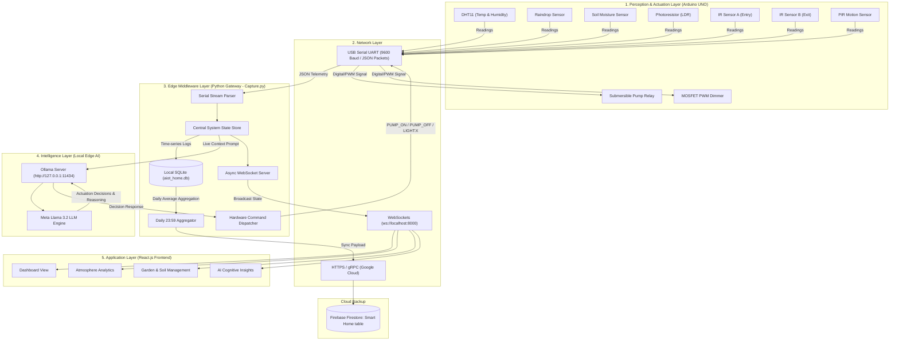

# 🌿 AIoT Smart Home & Precision Agriculture System

[](#-iot-architecture-layers)
[](https://www.arduino.cc/)
[](https://ollama.com/)
[](https://python.org)
[](https://react.dev/)
[](https://firebase.google.com/)

An intelligent, full-stack **Artificial Intelligence of Things (AIoT)** ecosystem combining embedded hardware sensing, closed-loop edge actuation, localized LLM cognitive intelligence, and a real-time reactive web dashboard. 

The system automates indoor climate monitoring, bidirectional room occupancy tracking, motion-activated smart lighting, precision crop care, and autonomous water tank replenishment powered by a local **Llama 3.2** model operating entirely offline on the edge.

---

## 📑 Table of Contents

- [System Architecture & Data Flow](#-system-architecture--data-flow)
- [IoT Architecture Layers](#-iot-architecture-layers)
  - [1. Perception Layer (Hardware & Sensing)](#1-perception-layer-sensing--actuation)
  - [2. Network & Connectivity Layer](#2-network--connectivity-layer)
  - [3. Edge Middleware Layer (Python Gateway)](#3-edge-middleware-layer-python-gateway)
  - [4. Intelligence & Cognitive Layer (Ollama / Llama 3.2)](#4-intelligence--cognitive-layer-local-llm)
  - [5. Application & Presentation Layer (React Dashboard)](#5-application--presentation-layer-react-dashboard)
- [Hardware Wiring & Pinout Guide](#-hardware-wiring--pinout-guide)
- [Repository Structure](#-repository-structure)
- [Step-by-Step Implementation Guide](#-step-by-step-implementation-guide)
  - [Prerequisites](#prerequisites)
  - [Step 1: Clone the Repository](#step-1-clone-the-repository)
  - [Step 2: Flash the Arduino Microcontroller](#step-2-flash-the-arduino-microcontroller)
  - [Step 3: Set Up Ollama Local AI](#step-3-set-up-ollama-local-ai)
  - [Step 4: Configure & Run Python Middleware](#step-4-configure--run-python-middleware)
  - [Step 5: Run the React Dashboard](#step-5-run-the-react-dashboard)
- [Data Protocols & Telemetry Schemas](#-data-protocols--telemetry-schemas)
- [Troubleshooting & FAQs](#-troubleshooting--faqs)
- [License](#-license)

---

## 🏗 System Architecture & Data Flow



---

## 🌐 IoT Architecture Layers

This project implements the standard **5-Layer Architecture of the Internet of Things (AIoT)**:

### 1. Perception Layer (Sensing & Actuation)
The physical layer responsible for interacting with the ambient environment.
- **Microcontroller**: Arduino UNO managing low-level hardware timers, analog-to-digital conversions (ADC), interrupts, and non-blocking scheduling.
- **Sensing Elements**:
  - **DHT11**: Accurately measures ambient room temperature (°C) and relative humidity (%).
  - **Rain Sensor (Analog)**: Detects real-time precipitation through conductive traces.
  - **Capacitive/Resistive Soil Moisture**: Reads root-zone moisture saturation levels.
  - **Light Dependent Resistor (LDR)**: Monitors natural illumination and ambient light intensity.
  - **Dual Infrared Obstacle Sensors (Sensors A & B)**: Configured in a directional break-beam finite state machine (FSM) to count bidirectional entries and exits of occupants.
  - **PIR Motion Sensor**: Detects thermal human presence with non-blocking 30-second thermal room calibration.
  - **Auxiliary Serial1 Module**: Collects auxiliary water tank and soil pH telemetry.
- **Actuation Elements**:
  - **Relay Module (Pin 8)**: Drives a 5V/12V DC submersible water pump for irrigation and reservoir refill.
  - **High-Power MOSFET Module (Pin 10)**: Provides smooth, non-blocking hardware PWM fading for ambient LED lighting based on motion and darkness.

### 2. Network & Connectivity Layer
The communication backbone facilitating bidirectional telemetry and control across heterogeneous protocols.
- **Edge Serial Bus**: Physical USB UART bus operating at 9600 baud between the Arduino and host computer. Uses structured JSON strings with newline terminators for serial telemetry and ASCII command strings (`PUMP_ON`, `PUMP_OFF`, `LIGHT:<0-100>`) for actuation.
- **Local Network Transport**: Asynchronous WebSocket Server running on `ws://localhost:8000` via Python `websockets` for zero-latency, sub-millisecond reactive state broadcasting to UI clients.
- **Cloud Transport**: Authenticated HTTPS/gRPC channels to Google Firebase Firestore for daily persistence and analytics.

### 3. Edge Middleware Layer (Python Gateway)
The orchestration engine (`pyscript/Capture.py`) executing locally on the host machine.
- **Serial Demultiplexer**: Non-blocking thread reading the USB COM port, deserializing JSON telemetry packets, and validating sensor data.
- **Central State Manager (`system_state`)**: High-speed, in-memory thread-safe dictionary representing the live digital twin of the environment.
- **Local Edge Persistence (`aiot_home.db`)**: Embedded SQLite3 database recording raw time-series measurements (`daily_logs`) locally without internet dependency.
- **Automated Lifecycle Scheduler**: A background cron evaluating daily at `23:59`:
  1. Computes mathematical averages (`AVG`) of temperature, humidity, moisture, pH, and water levels.
  2. Pushes the daily summary document to Google Firebase Firestore (`Smart Home table`).
  3. Cleans and vacuums the local database for the next operational cycle.
- **Actuator Controller**: Parses structured recommendations from the AI engine and dispatches immediate hardware control commands back through the serial link.

### 4. Intelligence & Cognitive Layer (Local LLM)
Cognitive edge computing that replaces static threshold rules with contextual generative intelligence.
- **Engine**: **Ollama** running **Meta Llama 3.2** locally on the edge device (`http://127.0.0.1:11434`).
- **Privacy & Reliability**: Zero cloud dependence for inference; ensures 100% data privacy and offline operational stability.
- **Context-Aware Decisions**:
  - **Dynamic Weather Forecasting**: Evaluates real-time barometric proxies (humidity shifts, temperature spikes, rain sensor triggers) to forecast short-term weather.
  - **Occupancy-Weighted Irrigation**: Adjusts reservoir refill thresholds dynamically based on how many people are currently occupying the home and crop requirements.
  - **Agronomic Nutrition Guidance**: Generates personalized fertilizer and soil amendment advice tailored to the currently planted crop (e.g., Tomato) and active soil pH.
  - **Explainable Decision Rationale (`REASON`)**: Provides natural language explanations for every hardware decision displayed directly on the UI.

### 5. Application & Presentation Layer (React Dashboard)
Modern, accessible, and reactive user interface built with React 19, Vite, and Tailwind CSS.
- **Real-Time Synchronization**: Connects to the edge WebSocket server upon load; updates reactive states without page reloads.
- **Modular Views**:
  - **Overview Dashboard (`/`)**: Bento-grid layout displaying active climate metrics, sparkline graphs, occupant presence, and system status.
  - **Atmosphere (`/atmosphere`)**: Detailed climatic trends, temperature vs. target variances, humidity circular gauges, and precipitation alerts.
  - **Gardens (`/gardens`)**: Precision agriculture dashboard showing live soil moisture percentages, pH tracking graphs, crop profiles, and pump controls.
  - **AI Insights (`/insights`)**: Cognitive center presenting real-time Llama 3.2 decision rationales, factoring inputs, and active actuator states.

---

## 🔌 Hardware Wiring & Pinout Guide

| Component | Pin Type | Arduino UNO Pin | Working Voltage | Description / Function |
| :--- | :--- | :--- | :--- | :--- |
| **DHT11 Sensor** | Digital I/O | `Pin 2` | 5V / 3.3V | Ambient Temperature & Humidity |
| **Raindrop Sensor** | Analog Input | `Pin A0` | 5V | Analog precipitation detection (Rain < 800) |
| **Soil Moisture Sensor** | Analog Input | `Pin A1` | 5V | Volumetric soil moisture reading |
| **Photoresistor (LDR)** | Analog Input | `Pin A3` | 5V | Ambient illumination intensity |
| **Doorway Sensor A** | Digital Input | `Pin 4` | 5V | Break-beam / IR obstacle (Entry trigger) |
| **Doorway Sensor B** | Digital Input | `Pin 5` | 5V | Break-beam / IR obstacle (Exit trigger) |
| **PIR Motion Sensor** | Digital Input | `Pin 9` | 5V | Passive infrared human motion detection |
| **Pump Relay Module** | Digital Output | `Pin 8` | 5V | Controls Submersible Water Pump |
| **MOSFET Module (Dimmer)**| PWM Output | `Pin 10` | 5V (Gate) | Smooth PWM dimming for LED lighting strip |
| **Auxiliary Telemetry** | Hardware Serial| `Serial1` (or SoftwareSerial) | 5V | External water module and pH telemetry |

---

## 📂 Repository Structure

```
AIOT_PROJECT/
├── Aiotscript/
│   └── Aiotscript.ino          # Arduino C++ Firmware (Sensors, Actuators, State Machines)
├── pyscript/
│   ├── Capture.py              # Python Edge Gateway (Serial, WebSockets, Ollama, SQLite, Firebase)
│   ├── requirements.txt        # Python dependency manifest
│   ├── aiot-key.json.example   # Template for Firebase Service Account Credentials
│   └── aiot_home.db            # Embedded SQLite Time-Series Database (Auto-created)
├── Frontend/
│   ├── index.html              # Single-page application entry point
│   ├── package.json            # Node.js dependencies and build scripts
│   ├── vite.config.js          # Vite build configuration
│   ├── tailwind.config.js      # Design tokens, color palette, typography
│   └── src/
│       ├── App.jsx             # Root component with WebSocket manager & routes
│       ├── main.jsx            # React DOM bootstrap
│       ├── index.css           # Global Tailwind and font styles
│       ├── components/
│       │   ├── Layout.jsx      # Navigation sidebar & responsive layout shell
│       │   └── CircularGauge.jsx # Reusable SVG Circular Metric Gauge
│       └── pages/
│           ├── Dashboard.jsx   # Bento-grid primary dashboard
│           ├── Atmosphere.jsx  # Climate, temperature & weather telemetry
│           ├── Gardens.jsx     # Soil moisture, pH, and irrigation management
│           └── Insights.jsx    # LLM decision rationale and cognitive factor viewer
└── README.md                   # Comprehensive System Documentation
```

---

## 🚀 Step-by-Step Implementation Guide

Follow these steps to set up, connect, and run the complete AIoT system locally on your machine.

### Prerequisites

Ensure you have the following installed on your host computer:
1. **[Arduino IDE 2.x](https://www.arduino.cc/en/software)**
2. **[Python 3.10+](https://www.python.org/downloads/)**
3. **[Node.js (v18 or higher)](https://nodejs.org/)** and `npm`
4. **[Ollama](https://ollama.com/)** (for local Llama 3.2 inference)
5. **Git**

---

### Step 1: Clone the Repository

```bash
git clone https://github.com/Kanishk-VR007/AIOT_PROJECT.git
cd AIOT_PROJECT
```

---

### Step 2: Flash the Arduino Microcontroller

1. Connect your **Arduino UNO** to your computer via USB.
2. Open the **Arduino IDE**.
3. Install required libraries via the **Library Manager** (`Ctrl + Shift + I`):
   - **DHT sensor library** by Adafruit
   - **Adafruit Unified Sensor**
4. Open the firmware file:
   - Navigate to `Aiotscript/Aiotscript.ino`.
5. Under the **Tools** menu:
   - **Board**: Select *Arduino Uno* (or compatible microcontroller).
   - **Port**: Select the corresponding COM port (e.g., `COM3` on Windows or `/dev/ttyUSB0` on Linux/macOS).
6. Click **Upload** (`Ctrl + U`).
7. Note down the active COM port for Step 4.

> **Note on Serial1**: If using a standard Arduino UNO (which has one hardware UART on pins 0/1), the `Serial1` reading handles external sensor data. If not using a multi-serial board (like Arduino Mega) or software serial, you can leave auxiliary telemetry unpopulated without affecting the core climate, motion, and irrigation routines.

---

### Step 3: Set Up Ollama Local AI

1. Start the Ollama local background daemon (if not already running):
   ```bash
   ollama serve
   ```
2. In a separate terminal, pull the **Llama 3.2** lightweight model:
   ```bash
   ollama pull llama3.2
   ```
3. Test that the model is operational:
   ```bash
   ollama run llama3.2 "Hello! Confirm you are ready."
   ```

---

### Step 4: Configure & Run Python Middleware

1. Navigate to the `pyscript` directory:
   ```bash
   cd pyscript
   ```

2. Create and activate a Python virtual environment:
   ```bash
   # Windows (PowerShell)
   python -m venv .venv
   .\.venv\Scripts\Activate.ps1

   # Linux / macOS
   python3 -m venv .venv
   source .venv/bin/activate
   ```

3. Install the required Python packages:
   ```bash
   pip install -r requirements.txt
   ```

4. **Verify the COM Port configuration**:
   Open `Capture.py` and ensure `ARDUINO_PORT` matches your Arduino's port:
   ```python
   ARDUINO_PORT = 'COM3'  # Replace with your actual port (e.g., COM4, /dev/ttyUSB0)
   BAUD_RATE = 9600
   ```

5. **Firebase Credentials (Optional / Daily Backup)**:
   - If using Firebase Firestore cloud backups, place your Firebase service account private key JSON file in `pyscript/aiot-key.json` (see `aiot-key.json.example`).
   - If running strictly locally without Firebase, you can mock or wrap the Firebase initialization lines (lines 23–30) with a `try/except` block.

6. Launch the Python Edge Gateway:
   ```bash
   python Capture.py
   ```
   You should see:
   ```text
   Initializing Local SQLite Database...
   WebSocket Server running on ws://localhost:8000
   Listening to Arduino on COM3...
   ```

---

### Step 5: Run the React Dashboard

1. Open a new terminal and navigate to the `Frontend` directory:
   ```bash
   cd Frontend
   ```

2. Install dependencies:
   ```bash
   npm install
   ```

3. Start the Vite development server:
   ```bash
   npm run dev
   ```

4. Open your browser and navigate to:
   ```
   http://localhost:5173
   ```
   The dashboard will automatically connect to `ws://localhost:8000` and stream live data directly from your Arduino and Ollama AI.

---

## 📊 Data Protocols & Telemetry Schemas

### 1. Arduino Uplink Telemetry (Serial JSON to Python)

```json
// Climate Data
{"type": "climate", "temperature": 24.5, "humidity": 55.0, "rain_value": 950, "is_raining": false}

// Garden & Soil Data
{"type": "garden", "ldr_value": 320, "water_level_percent": 80, "water_raw": 3, "soil_moisture_percent": 65, "pump_status": false, "module_serial_raw": "PH:6.8,W:3"}

// Occupancy Counter Data
{"type": "occupancy", "occupancy": 3, "event": "Entry"}

// Smart Lighting Motion Data
{"type": "lighting", "motion": true}
```

### 2. Downlink Actuation Commands (Python to Arduino)

- `PUMP_ON\n` — Engages Relay Pin 8 to activate the water pump.
- `PUMP_OFF\n` — Disengages Relay Pin 8 to turn off the water pump.
- `LIGHT:<0-100>\n` — Sets target PWM duty cycle on Pin 10 (e.g., `LIGHT:75`).

### 3. WebSocket Real-Time Broadcast Schema (Python to React)

```json
{
  "occupancy": 2,
  "temperature": 25.1,
  "humidity": 48.3,
  "rain_detected": false,
  "water_level_percent": 75,
  "soil_moisture_percent": 62,
  "soil_ph": 6.8,
  "ldr_value": 280,
  "pump_status": false,
  "planted_crop": "Tomato",
  "weather_prediction": "Partly Cloudy with high humidity",
  "ai_suggestion": "Soil nitrogen levels optimal for current phase. Maintain standard irrigation.",
  "ai_reasoning": "Tank level is at 75% which is above the 40% threshold; pump remains OFF."
}
```

---

## 🛠 Troubleshooting & FAQs

### 1. `Serial connection error: could not open port 'COMx'`
- **Cause**: The COM port is incorrect or currently open in the Arduino IDE Serial Monitor.
- **Fix**: Close the Arduino IDE Serial Monitor and confirm the exact port name in Device Manager (Windows) or via `ls /dev/tty*` (Linux/Mac).

### 2. `[AI ERROR] Could not connect to local Ollama server`
- **Cause**: The Ollama service is not running or blocked by a local firewall.
- **Fix**: Run `ollama serve` in a terminal and confirm accessibility by opening `http://127.0.0.1:11434` in your browser.

### 3. `FileNotFoundError: aiot-key.json`
- **Cause**: Google Firebase service credentials are missing.
- **Fix**: If you don't need cloud backups, wrap lines 24–30 of `Capture.py` in a `try...except` block, or create an `aiot-key.json` file following `aiot-key.json.example`.

### 4. WebSocket Disconnection on Frontend
- **Cause**: Python `Capture.py` script is not running or failed during boot.
- **Fix**: Ensure `Capture.py` is running and outputs `WebSocket Server running on ws://localhost:8000`.

---

Feel free to adapt, extend, and deploy it for research, home automation, and precision agricultural applications.
